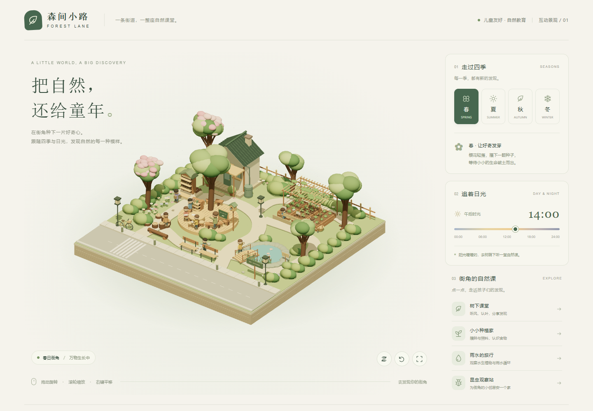

# natural education · 森间小路

基于 Three.js 的可交互微缩景观。所有街道、活动设施、植被和人物搭建在完整的 16 × 16 方形底座上，采用正交相机呈现模型感。



## GitHub Pages

仓库使用 `.github/workflows/pages.yml` 自动构建并发布静态页面。推送至 `main` 后，GitHub Actions 执行依赖安装、语法检查、构建和部署。Pages 的 Source 设置为 **GitHub Actions**。

`npm run build` 将可独立部署的网站生成至 `dist/`，Three.js 及相机控制组件一起复制到站点内，部署页面无需访问 `node_modules` 或第三方模型服务。

## 本地预览

在此目录运行：

```sh
npm install
npm start
```

浏览器打开 http://127.0.0.1:4173 。已安装依赖时无需再次运行 npm install。需要通过本地服务打开，直接双击 HTML 时，浏览器对 ES 模块的文件访问限制可能阻止模型加载。

## 交互

- 鼠标左键拖动旋转，右键拖动平移，滚轮缩放。
- 触屏单指旋转，双指缩放与平移。
- 春夏秋冬按钮联动改变树叶、花朵、果实、落叶、积雪、作物、人物衣服、围巾与遮阳帽。
- 00:00–24:00 滑条实时改变太阳方向、光照颜色、阴影、夜间灯光与窗户亮度。季节同时改变日照时长与太阳高度，让夏日晚些入夜、冬日影子更长。
- 点击模型中的活动设施或右侧活动列表，查看活动介绍和对应季节的自然观察任务。
- 下方圆形按钮支持自动环绕、视角复位、全屏查看。

## 文件

- `index.html`：中文界面与交互控件。
- `styles.css`：响应式界面与全屏布局。
- `scene.js`：程序化三维建模、季节与昼夜联动、相机控制。
- `server.mjs`：无额外依赖的本地静态服务。

所有几何与图形纹理均由代码生成，无需远程模型或图片。Three.js 从本地 node_modules 加载；中文衬线字体为可选在线字体，离线时自动使用本机字体。浏览器需要支持 WebGL。
